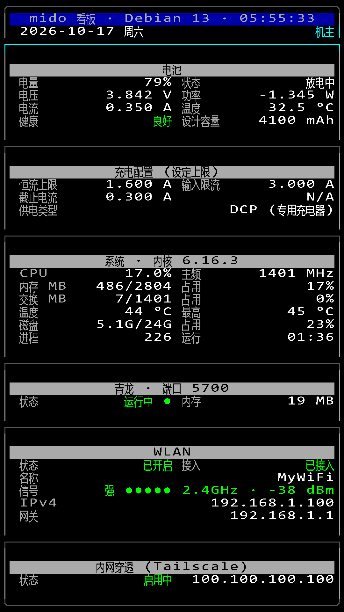
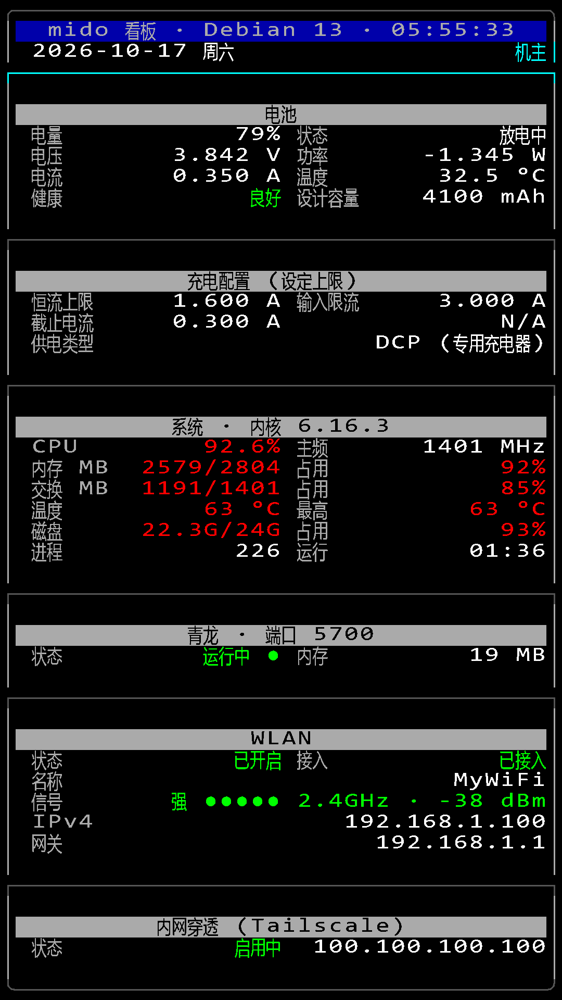

# 终端看板（Console Panel）

在 **TTY1** 上用纯 bash 画的一屏系统监控面板，**不需要桌面环境**：
36 列 × 48 行的字符界面，每 5 秒刷新一次，把电池 / 充电配置 / 系统负载 / 青龙面板 / WLAN /
内网穿透六组状态全部铺在一屏里。

本项目（[debian-on-mido](https://github.com/calico-cat-3333/debian-on-mido)）的镜像装好之后，
tty1 上默认只有一个登录提示符。这个看板就是把那块屏利用起来：开机自启、常驻显示，
像一块挂在墙上的「系统状态牌」。

CPU / 内存 / 交换 / 温度 / 磁盘超过阈值会自动变黄、变红，一眼能看出哪项不对：

## 说明

* **基于本项目的镜像制作**，在同一套 Debian 13 trixie + `6.16.3-calicocat-msm8953+` 内核上开发和实测；
* 只依赖 bash 和几个基础命令（`awk` / `ip` / `iw` / `df` / `ss` / `tailscale`），
  不装 Node、不装 Python 也能跑；
* 单帧 CPU 开销约 **0.265 秒**（8 核 A53，折合整机约 0.036%），常驻内存 1.5～2.8 MB；
* 中文能正常显示，是因为配了一套**自制的 30×40 控制台点阵字体**（含常用汉字），
  并按「预编译成 PUA 码点」的方式让每个汉字只占 1 格 —— 这也是这份看板排版能做得比较紧凑的原因。

## 安装

### 项目仓库
完整源码、安装包与脚本已迁移至独立仓库：
https://github.com/Chineseguy66/console-panel-mido

### 部署步骤
所有安装命令、参数配置、修改署名、卸载流程，全部查看独立仓库内的 README。

## 改成你自己的署名

自定义机主名称、重新编译字体等操作，请参考独立仓库文档。

## 注意事项

* **屏幕必须是 1080×1920**。字体固定 30×40，栅格固定 36 列 × 48 行，`install.sh` 会硬校验分辨率，
  不符就直接停下 —— 换分辨率要重新生成字体并改栅格常量，不是 `--force` 能绕过的。
* **部署到 `/usr/local/bin/battery-panel.sh` 的那份是预编译版，不要直接改它**。
  要改就改源码文件，再执行编译脚本，详细步骤在独立仓库。
* 调试不要用 `bash -x` 往 `/tmp` 写日志。这个镜像里 `/tmp` 是 tmpfs（内存文件系统），
  整脚本追踪一次会输出三万行以上日志，**直接把内存打满**，然后被 OOM 杀掉。
  真要追踪就写到磁盘目录（如 `/var/log/`），并且只在排查问题时用，正式运行不要带。
* 字体同时放在两个路径：`/usr/local/share/consolefonts/mido-30x40.psf`（`setfont` 直接加载）和
  `/usr/share/consolefonts/Uni2-mido40x30.psf.gz`（`console-setup` 按 `Uni2-<FACE><SIZE>` 规则查找）。
  **两处必须同内容**，少一处会在不同的启动路径下掉回默认字体。
* 看板会每帧清屏，所以**看不到 tty1 的登录提示符**，这是正常的。
  如果需要在 tty1 上敲命令，就先 `sudo systemctl stop battery-panel`。

## 卸载

卸载脚本与命令请查看独立仓库文档。